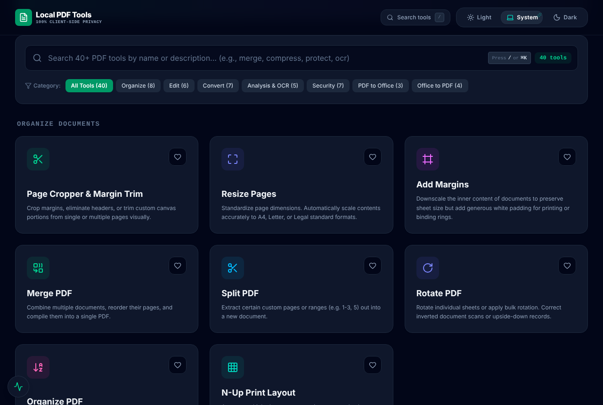

<div align="center">


# Local PDF Tools

**40 PDF tools, 38 of which run entirely in your browser. Your files never leave your device.**

Merge, split, compress, OCR, sign, redact, edit, watermark and more. Free, open source, no sign-up, no uploads, no watermarks, no limits.

[**Try it live →**](https://alqudah.github.io/local-pdf-tools/) &nbsp;·&nbsp; [**Download the desktop app**](#-desktop-app) &nbsp;·&nbsp; [Self-host](#-self-hosting) &nbsp;·&nbsp; [Report a bug](https://github.com/alqudah/local-pdf-tools/issues/new/choose) &nbsp;·&nbsp; [Request a tool](https://github.com/alqudah/local-pdf-tools/issues/new?template=feature_request.yml)

[](https://github.com/alqudah/local-pdf-tools/actions/workflows/ci.yml)
[](LICENSE)
[](https://github.com/alqudah/local-pdf-tools/stargazers)
[](CONTRIBUTING.md)



</div>

---

## Why?

Most "free" online PDF tools make you **upload your documents to someone else's server**: contracts, IDs, bank statements, medical records. Then they add watermarks, daily limits, or a paywall.

Local PDF Tools does the work **inside your browser** with WebAssembly and JavaScript. The PDF is read into memory, processed on your own CPU, and saved straight back to your disk. There's nothing to upload and nothing to trust.

- 🔒 **Private by design.** Your documents never leave your device, so it's safe for sensitive and confidential files.
- ⚡ **Fast.** No upload or download wait. Big files are limited only by your machine.
- 💸 **Free forever.** No accounts, no ads, no watermarks, no "3 tasks per day" limits.
- 🔗 **Chain tools and save workflows.** Merge, then compress, then protect, without downloading and re-uploading in between. Save a sequence as a workflow and rerun it any time.
- 🧰 **40 tools in one place**, with instant search (`/` or `⌘K`), pinned favorites and dark mode.
- 💻 **Desktop app for Windows, macOS and Linux**, with all 40 tools working fully offline.
- 📲 **Installable web app.** Install it from your browser and it works offline after the first visit.
- 🌍 **English and Arabic** across the whole app, with a full right-to-left layout. [Add your language](CONTRIBUTING.md#translating)!
- 🏠 **Self-hostable.** Run it on your laptop, your intranet, or as a static site on any CDN.

> **Don't trust us, verify it:** open DevTools → Network, then run any browser tool. You won't see your file go anywhere.

## Features

| Category | Tools |
|---|---|
| **Organize** | Merge · Split · Organize / reorder pages · Rotate · Crop & trim margins · Resize pages (A4/Letter/Legal) · Add margins · N-up print layout |
| **Edit** | In-browser PDF editor · Add page numbers · Bates numbering & legal stamps · Form builder · Form filler · Flatten forms & annotations |
| **Convert & optimize** | Compress · PDF → images · Images → PDF · Batch converter · Text & Markdown extractor · Grayscale / monochrome |
| **Scan & analyze** | OCR (18 languages incl. Arabic, Chinese, Japanese; searchable PDF output) · Camera document scanner · Visual diff / compare two PDFs · Metadata editor |
| **Security** | Password-protect (standard AES-256) · Unlock · Permanent redaction · Signatures (draw, type, upload) · Watermarks · Template overlay · Repair corrupted PDFs |
| **Office & archiving** | PDF ↔ Word · PDF ↔ PowerPoint · PDF ↔ Excel · HTML → PDF · PDF/A-2b preparation (text-based Office conversions) |
| **Server features** *(self-hosted or desktop)* | AI translation (your own Gemini key) · Convert a web page by URL |

### Privacy model: what runs where

| | Where it runs | Notes |
|---|---|---|
| **Browser tools** (38 of 40, including Office conversions and PDF/A) | 100% in your browser | Files are never transmitted. Works on the static demo and offline. |
| **AI Translate** and **web page by URL** (2 of 40) | On the Node.js server **you** run, or inside the desktop app | Clearly labeled. On the static demo they're disabled and nothing is sent. Translate sends the document's text to Google Gemini, only with your own API key. |
| **Desktop app** (40 of 40) | On your computer | The app runs its own server on `127.0.0.1` only. Nothing is reachable from your network. |

A few browser tools download open-source **assets** (never your documents) the first time you use them: OCR language models and fonts for non-Latin searchable PDFs (jsDelivr), and handwriting-style signature fonts (Google Fonts). The OCR engine itself and the PDF engine are bundled with the app. Self-hosters can serve the OCR assets themselves too; see [Configuration](#configuration).

## Quick start

### Use it online

👉 **<https://alqudah.github.io/local-pdf-tools/>**

In Chrome, Edge or Safari you can also **install** it (address-bar install icon, or *Share → Add to Home Screen* on iPhone). After the first visit, the browser tools work offline.

## 💻 Desktop app

Download the installer for your system from the [**latest release**](https://github.com/alqudah/local-pdf-tools/releases/latest):

| System | File |
|---|---|
| Windows 10/11 | `Local-PDF-Tools-x.y.z-win-x64.exe` |
| macOS, Apple Silicon (M1–M4) | `Local-PDF-Tools-x.y.z-mac-arm64.dmg` |
| macOS, Intel | `Local-PDF-Tools-x.y.z-mac-x64.dmg` |
| Linux | `Local-PDF-Tools-x.y.z-linux-x86_64.AppImage` or `.deb` |

All 40 tools work offline in the desktop app, including the Office converters. Install and go. (The optional AI **Translate PDF** tool asks for your own free Gemini API key and sends the document's text to Google only when you use it.)

> The installers are not code-signed yet, so your system may warn you the first time:
> - **Windows:** "Windows protected your PC" → **More info** → **Run anyway**.
> - **macOS:** open the app once, then **System Settings → Privacy & Security → Open Anyway**.
> - **Linux AppImage:** `chmod +x Local-PDF-Tools-*.AppImage`, then run it.

### Run locally

Requires **Node.js 20+**.

```bash
git clone https://github.com/alqudah/local-pdf-tools.git
cd local-pdf-tools
npm install
npm run dev
```

Open <http://localhost:3000>. All 40 tools are available, including the server-backed Office converters.

## 🏠 Self-hosting

### Build the desktop app yourself

```bash
npm ci
npm run desktop        # run it
npm run desktop:dist   # build an installer for your OS into release/
```

### Option 1: Docker (full app, all 40 tools)

```bash
docker build -t local-pdf-tools .
docker run -p 3000:3000 local-pdf-tools
```

Or with Docker Compose:

```bash
docker compose up -d
```

### Option 2: Node.js (full app)

```bash
npm ci
npm run build
npm start
```

### Option 3: Static hosting (browser tools only)

Build a plain static site and upload `dist/` anywhere: GitHub Pages, Netlify, Vercel, Cloudflare Pages, S3, nginx.

```bash
npm ci
npm run build:client
```

When serving from a sub-path (e.g. `https://you.github.io/local-pdf-tools/`), set `BASE_PATH`:

```bash
BASE_PATH=/local-pdf-tools/ npm run build:client
```

This repo ships a [GitHub Pages workflow](.github/workflows/deploy-pages.yml). To use it on your fork, go to **Settings → Pages → Source: GitHub Actions**.

### Configuration

All optional, and only used by the Node server. See [`.env.example`](.env.example).

| Variable | Default | Purpose |
|---|---|---|
| `PORT` | `3000` | HTTP port |
| `HOST` | `0.0.0.0` | Interface to bind |
| `GEMINI_API_KEY` | (none) | Enables the AI **Translate PDF** tool |
| `GEMINI_MODEL` | `gemini-3.5-flash` | Gemini model used for translation |

Build-time options for the browser app (set when running `npm run build` / `build:client`):

| Variable | Purpose |
|---|---|
| `BASE_PATH` | Serve from a sub-path, e.g. `/local-pdf-tools/` |
| `VITE_TESSDATA_URL` | Folder with OCR language models (`eng.traineddata.gz`, ...) to avoid the jsDelivr CDN, e.g. `/tessdata`. Get files from [`@tesseract.js-data`](https://www.npmjs.com/search?q=%40tesseract.js-data) (`4.0.0_best_int`). |
| `VITE_OCR_FONT_URL` | Folder with the `.ttf` fonts used for non-Latin searchable PDFs (same file names as in `OcrTool.tsx`) |

## Tech stack

- **UI:** React 19, TypeScript, Tailwind CSS v4, Lucide icons, dnd-kit, Motion
- **PDF engines:** [pdf-lib](https://github.com/Hopding/pdf-lib) (write/modify), [PDF.js](https://github.com/mozilla/pdf.js) (render/parse, worker bundled locally)
- **OCR:** [Tesseract.js](https://github.com/naptha/tesseract.js)
- **Encryption:** [qpdf](https://github.com/qpdf/qpdf) compiled to WebAssembly
- **Optional server:** Express, `docx`, `exceljs`, `pptxgenjs`, `mammoth`, `pdf-parse`
- **Desktop:** Electron, electron-builder
- **Build & test:** Vite, esbuild, Playwright

## Project structure

```
src/
  App.tsx              # Dashboard, search, tool registry & routing
  i18n.tsx             # Language switching, tr() and RTL handling
  locales/ar.ts        # Arabic translations
  components/*Tool.tsx # One lazily loaded component per tool
  lib/pdfUtils.ts      # Shared PDF helpers (pdf-lib + PDF.js)
  lib/pdfjs.ts         # PDF.js worker setup (bundled, no CDN)
  lib/qpdf.ts          # Standard PDF encryption (qpdf WebAssembly)
  lib/ocrAssets.ts     # Where OCR engine and language data load from
server.ts              # Express server for Office/HTML/translate tools
desktop/               # Electron desktop app
tests/                 # Playwright browser tests
```

## Roadmap

- [x] Installable PWA with full offline support
- [x] Desktop app for Windows, macOS and Linux
- [x] Arabic and right-to-left layout
- [ ] More languages (French, Spanish, Turkish, ...): [help translate](CONTRIBUTING.md#translating)
- [x] Office conversions and PDF/A in the browser
- [ ] Layout-preserving Office conversions (images, tables, fonts)
- [x] Tool chaining ("Continue with…")
- [x] Saved, reusable workflows
- [ ] Fully automatic batch runs (one workflow over many files)
- [ ] Code-signed desktop installers
- [ ] Browser tests for every tool

Have an idea? [Open a feature request](https://github.com/alqudah/local-pdf-tools/issues/new?template=feature_request.yml).

## Contributing

Contributions of every size are welcome: bug reports, new tools, translations, docs. Read the [contributing guide](CONTRIBUTING.md) to get started. Issues labeled [`good first issue`](https://github.com/alqudah/local-pdf-tools/labels/good%20first%20issue) are a great entry point.

Please follow our [Code of Conduct](CODE_OF_CONDUCT.md). Found a security issue? See [SECURITY.md](SECURITY.md).

## Support the project

If Local PDF Tools saved you from uploading a sensitive document somewhere, **[give it a ⭐ on GitHub](https://github.com/alqudah/local-pdf-tools)**. It helps others find it.

## License

[Apache-2.0](LICENSE). Free for personal and commercial use.
